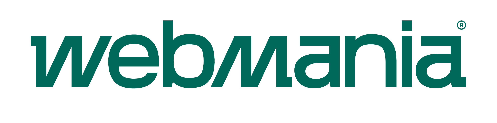

<p align="center"></p>

# Webmania SDK para Kotlin

Através do emissor fiscal da Webmania®, você conta com a emissão e o arquivamento dos seus documentos fiscais, cálculo automático de impostos, geração do DANFE para impressão e envio automático de e-mails para os clientes. Com este SDK, o seu sistema em Kotlin se integra à nossa REST API para emitir, consultar e cancelar NF-e, NFC-e, NFS-e, CT-e, MDF-e, NFCom e DC-e, baixar XML e PDF dos documentos e usar o Monitor Fiscal.

- Emissor de Nota Fiscal Webmania®: [Saiba mais](https://webmania.com.br/nota-fiscal-eletronica/)
- Documentação da REST API: [Visualizar](https://webmania.com.br/docs/)
- Índice da documentação para assistentes de IA: [llms.txt](https://webmania.com.br/docs/llms.txt)

## Requisitos

- Contrate um dos planos de Nota Fiscal Eletrônica da Webmania®: [Assine agora mesmo](https://webmania.com.br/nota-fiscal-eletronica/#plans-section).
- Kotlin 2.4 (JVM), JDK 17 ou superior e Maven 3.9.
- O SDK para Java, instalado junto (passo abaixo); as chamadas são bloqueantes.
- Credenciais de acesso da sua empresa, disponíveis no [Painel de Controle](https://webmania.com.br/painel/).

## Instalação

O SDK é distribuído pelo repositório [github.com/webmaniabr/webmania-kotlin](https://github.com/webmaniabr/webmania-kotlin) e ainda não está publicado no Maven Central. Clone o SDK para Java e este SDK e instale os dois, nessa ordem, no mesmo repositório Maven local:

```sh
git clone https://github.com/webmaniabr/webmania-java.git
git clone https://github.com/webmaniabr/webmania-kotlin.git
mvn -B -ntp -f webmania-java/pom.xml -Dmaven.repo.local=/caminho/feed-maven install
mvn -B -ntp -f webmania-kotlin/pom.xml -Dmaven.repo.local=/caminho/feed-maven install
```

Declare a dependência no `pom.xml` da sua aplicação:

```xml
<dependency>
  <groupId>com.webmania</groupId>
  <artifactId>webmania-sdk-kotlin</artifactId>
  <version>0.1.0-alpha.10</version>
</dependency>
```

Compile a aplicação com o mesmo repositório local (`mvn -Dmaven.repo.local=/caminho/feed-maven compile`), que recebeu os dois SDKs e as suas dependências no `install`.

## Credenciais

Cada serviço usa a sua própria credencial. Guarde-as em variáveis de ambiente (ou em um cofre de segredos) no servidor e nunca as escreva no código-fonte:

| Variável de ambiente | Uso |
|---|---|
| `WEBMANIA_CONSUMER_KEY`, `WEBMANIA_CONSUMER_SECRET`, `WEBMANIA_ACCESS_TOKEN`, `WEBMANIA_ACCESS_TOKEN_SECRET` | NF-e e NFC-e (`NfeClient`) e arquivos da NF-e (`NfeFilesClient`) |
| `WEBMANIA_ISSUER_TOKEN` | NFS-e, CT-e, MDF-e, NFCom e DC-e (`EmitterClient`) e seus arquivos (`EmitterFilesClient`) |
| `WEBMANIA_MONITOR_TOKEN` | Monitor Fiscal (`MonitorClient`) |

```kotlin
import com.fasterxml.jackson.databind.JsonNode
import com.fasterxml.jackson.databind.ObjectMapper
import com.webmania.sdk.ApiException
import com.webmania.sdk.kotlin.*
import com.webmania.sdk.model.api1files.*
import com.webmania.sdk.model.api1fiscal.*
import com.webmania.sdk.model.api2emitterreads.*
import com.webmania.sdk.model.api2nfseissuance.*
import java.io.File

val credenciais = CompanyCredentials.create(
    System.getenv("WEBMANIA_CONSUMER_KEY"), System.getenv("WEBMANIA_CONSUMER_SECRET"),
    System.getenv("WEBMANIA_ACCESS_TOKEN"), System.getenv("WEBMANIA_ACCESS_TOKEN_SECRET"))
val nfe = NfeClient(credenciais)                                    // NF-e e NFC-e
val arquivos = NfeFilesClient(NfeFileAuth.company(credenciais))     // arquivos da NF-e
val emissor = EmitterClient(IssuerCredentials.create(System.getenv("WEBMANIA_ISSUER_TOKEN")))  // NFS-e, CT-e, MDF-e, NFCom e DC-e
val json = ObjectMapper()
```

Os clientes são `AutoCloseable`: reutilize as instâncias e feche-as com `close()` (ou `use { }`) ao terminar. Cada operação devolve um `ApiResult`: `status()` traz o status HTTP e `data().toJson()` o JSON da resposta.

## Utilização

Os exemplos abaixo usam o ambiente de **homologação** (`ambiente` 2), em que os documentos não têm validade fiscal. Para emitir em produção, envie `ambiente` 1. Os pedidos são montados a partir de JSON; informe valores decimais como texto (`"44.90"`) para manter a precisão.

### Status do SEFAZ e certificado A1

```kotlin
val sefaz = nfe.nfeGetSefazStatus().data().toJson()
println(sefaz.path("status").asText())              // online ou offline

val certificado = nfe.nfeGetCertificateValidity().data().toJson()
println(certificado.path("expiration").asInt())     // dias até o vencimento do certificado A1
```

### Emitir NF-e

Para emitir uma NF-e, use o método `nfeIssueDocument` com o JSON da nota no campo `body`. O mesmo método emite NFC-e com `"modelo": 2`.

```kotlin
val dados: JsonNode = json.readTree("""
    {
      "operacao": 1,
      "natureza_operacao": "Venda de produção do estabelecimento",
      "modelo": 1,
      "finalidade": 1,
      "ambiente": 2,
      "cliente": {
        "cpf": "000.000.000-00", "nome_completo": "Nome do Cliente",
        "endereco": "Av. Brg. Faria Lima", "numero": "1000", "bairro": "Itaim Bibi",
        "cidade": "São Paulo", "uf": "SP", "cep": "00000-000", "email": "nome@email.com"
      },
      "produtos": [{
        "nome": "Nome do produto", "codigo": "nome-do-produto", "ncm": "6109.10.00",
        "quantidade": "1", "unidade": "UN", "origem": 0,
        "subtotal": "44.90", "total": "44.90", "classe_imposto": "REF1000"
      }],
      "pedido": {"presenca": 2, "modalidade_frete": 9, "pagamento": 0, "forma_pagamento": "01", "total": "44.90"}
    }
""")

val nota = nfe.nfeIssueDocument(NfeIssueDocumentRequest(json.createObjectNode().set<JsonNode>("body", dados))).data().toJson()
val uuid = nota.path("uuid").asText()           // identificador único da nota fiscal
println(nota.path("status").asText())           // aprovado, reprovado, processamento...
println(nota.path("nfe").asText())              // número da NF-e
println(nota.path("serie").asText())            // série
println(nota.path("chave").asText())            // chave de acesso
println(nota.path("xml").asText())              // URL do XML
println(nota.path("danfe").asText())            // URL do DANFE (PDF)
println(nota.path("motivo").asText())           // retorno do SEFAZ
```

Somente o status `aprovado` indica uma nota autorizada. Quando o retorno for `processamento`, consulte a nota alguns segundos depois.

### Consultar NF-e

```kotlin
val consulta = nfe.nfeGetDocument(NfeGetDocumentRequest(json.createObjectNode().put("uuid", uuid))).data().toJson()
println(consulta.path("status").asText())
```

A consulta também aceita a chave de acesso (`chave`).

### Cancelar NF-e

```kotlin
val cancelamento = json.createObjectNode()
    .put("uuid", uuid)
    .put("motivo", "Cancelamento por erro no pedido.")   // mínimo de 15 caracteres
val cancelada = nfe.nfeCancelDocument(NfeCancelDocumentRequest(json.createObjectNode().set<JsonNode>("body", cancelamento))).data().toJson()
println(cancelada.path("status").asText())
```

### Baixar o DANFE e o XML

```kotlin
val danfe = arquivos.nfeDownloadDanfe(NfeDownloadDanfeRequest(json.createObjectNode().put("identifier", uuid))).data()
File("danfe.pdf").writeBytes(danfe.bytes())

val xml = arquivos.nfeDownloadXml(NfeDownloadXmlRequest(json.createObjectNode().put("identifier", uuid))).data()
File("nfe.xml").writeBytes(xml.bytes())
```

### Emitir, consultar e cancelar NFS-e

A NFS-e é emitida a partir de um ou mais RPS com o método `emitterIssueNfse`:

```kotlin
val rps: JsonNode = json.readTree("""
    {
      "ambiente": 2,
      "rps": [{
        "servico": {
          "valor_servicos": "15.00",
          "discriminacao": "Prestação de serviço referente ao mês 10/2026",
          "classe_imposto": "REF000000"
        },
        "tomador": {"cpf": "000.000.000-00", "nome_completo": "Nome do tomador"}
      }]
    }
""")
val nfse = emissor.emitterIssueNfse(EmitterIssueNfseRequest(json.createObjectNode().set<JsonNode>("body", rps))).data().toJson()
val uuidNfse = nfse.path("uuid").asText()
println(nfse.path("status").asText())

val consultaNfse = emissor.emitterGetNfse(EmitterGetNfseRequest(json.createObjectNode().put("identifier", uuidNfse))).data().toJson()
println(consultaNfse.path("status").asText() + " " + consultaNfse.path("numero").asText())

val cancela = json.createObjectNode()
    .put("uuid", uuidNfse)
    .put("motivo", "1")                                    // código do motivo (veja a documentação da NFS-e)
    .put("justificativa", "Serviço cancelado a pedido do tomador.")  // mínimo de 15 caracteres
val canceladaNfse = emissor.emitterCancelNfse(EmitterCancelNfseRequest(json.createObjectNode().set<JsonNode>("body", cancela))).data().toJson()
println(canceladaNfse.path("status").asText())
```

### Tratamento de erros

Toda falha lança `ApiException` (do SDK para Java):

```kotlin
try {
    nfe.nfeIssueDocument(NfeIssueDocumentRequest(json.createObjectNode().set<JsonNode>("body", dados)))
} catch (erro: ApiException) {
    println(erro.kind())        // VALIDATION (dados recusados antes do envio), API (recusa da API ou do SEFAZ), HTTP, TIMEOUT...
    println(erro.status())      // status HTTP, quando houver
    println(erro.message)       // mensagem, com dados sensíveis mascarados
    if (erro.outcomeUncertain()) {
        // A requisição pode ter sido processada: consulte a nota antes de emitir de novo.
    }
}
```

O SDK não repete requisições automaticamente. Se uma emissão ou um cancelamento terminar com resultado desconhecido (`outcomeUncertain()` verdadeiro), consulte o documento antes de tentar novamente, para não emitir em duplicidade.

## Métodos disponíveis

**NF-e e NFC-e** — `NfeClient`

- **nfeIssueDocument**: Emissão de NF-e ou NFC-e junto ao SEFAZ.
- **nfeGetDocument**: Consulta da nota fiscal pelo UUID, pela chave de acesso ou pelo ID do pedido.
- **nfeCancelDocument**: Cancelamento de NF-e ou NFC-e.
- **nfeCreateCorrection**: Carta de correção.
- **nfeVoidNumbering**: Inutilização de sequência de numeração.
- **nfeIssueReturn**: Emissão de NF-e de devolução.
- **nfeIssueComplement**: Emissão de NF-e complementar.
- **nfeIssueAdjustment**: Emissão de NF-e de ajuste.
- **nfeCreateManifestation**: Manifestação do destinatário.
- **nfeCreatePaymentEvent** / **nfeCancelPaymentEvent**: Evento de conciliação financeira (ECONF) e o seu cancelamento.
- **nfeCreateIbsCbsEvent** / **nfeCancelIbsCbsEvent**: Eventos de IBS/CBS e o seu cancelamento.
- **nfeListTaxClasses** / **nfeSaveTaxClasses** / **nfeDeleteTaxClasses**: Classes de imposto.
- **fiscalCreateOrPollReport**: Relatórios fiscais.
- **fiscalUpdateCompany**: Atualização dos dados da empresa emissora.
- **nfeGetSefazStatus**: Verifica se o SEFAZ está online ou offline.
- **nfeGetCertificateValidity**: Verifica quantos dias faltam para o certificado A1 expirar.

**NFS-e** — `EmitterClient`

- **emitterIssueNfse**: Emissão de NFS-e a partir de RPS.
- **emitterGetNfse**: Consulta da NFS-e.
- **emitterCancelNfse**: Cancelamento da NFS-e.
- **emitterReplaceNfse**: Substituição de NFS-e.
- **emitterManifestNfse**: Manifestação sobre NFS-e nacional.
- **emitterGetNfseProviderStatus**: Recursos do provedor de NFS-e do município da empresa.

**CT-e e CT-e OS** — `EmitterClient`

- **emitterIssueCte** / **emitterIssueSimplifiedCte**: Emissão de CT-e, CT-e OS e CT-e simplificado.
- **emitterGetCte**: Consulta do CT-e.
- **emitterCancelCte**: Cancelamento do CT-e.
- **emitterCorrectCte**: Carta de correção do CT-e.
- **emitterConfirmCteDelivery** / **emitterCancelCteDelivery**: Comprovante de entrega e o seu cancelamento.
- **emitterLinkCtePayment** / **emitterCancelCtePaymentLink** / **emitterGetCtePaymentEvents**: Eventos de pagamento do CT-e.

**MDF-e** — `EmitterClient`

- **emitterIssueMdfe**: Emissão do MDF-e.
- **emitterGetMdfe**: Consulta do MDF-e pela chave de acesso.
- **emitterCloseMdfe**: Encerramento do MDF-e.
- **emitterCancelMdfe**: Cancelamento do MDF-e.
- **emitterAddMdfeConductor**: Inclusão de condutor.

**NFCom e DC-e** — `EmitterClient`

- **emitterIssueNfcom** / **emitterGetNfcom** / **emitterCancelNfcom**: Emissão, consulta e cancelamento da NFCom.
- **emitterGetNfcomPaymentEvents**: Eventos de pagamento da NFCom.
- **emitterGetNfcomServiceStatus**: Disponibilidade do serviço da NFCom no SEFAZ.
- **emitterIssueDce** / **emitterGetDce** / **emitterCancelDce**: Emissão, consulta e cancelamento da DC-e.

**Arquivos (XML e PDF)** — `NfeFilesClient` e `EmitterFilesClient`

- **nfeDownloadDanfe** / **nfeDownloadSimpleDanfe** / **nfeDownloadLabelDanfe**: DANFE completo, simplificado e etiqueta.
- **nfeDownloadXml** / **nfeDownloadCancellationXml**: XML da NF-e e do cancelamento.
- **nfeDownloadCorrectionPdf** / **nfeDownloadCorrectionXml**: PDF e XML da carta de correção.
- **fileGetNfseXml** / **fileGetNfsePdf** / **fileGetNfseRpsPdf**: XML e PDF da NFS-e e PDF do RPS.
- **fileGetCteXml** / **fileGetCtePdf** / **fileGetMdfeXml** / **fileGetMdfePdf** / **fileGetNfcomXml** / **fileGetNfcomPdf** / **fileGetDceXml** / **fileGetDcePdf**: XML e PDF de CT-e, MDF-e, NFCom e DC-e.

**Monitor Fiscal** — `MonitorClient`

- **monitorSearchDocuments** / **monitorGetDocument** / **monitorListDocumentEvents**: Busca e consulta de documentos recebidos e do histórico de eventos.
- **monitorManifestDocument**: Manifestação do destinatário.
- **monitorImportDocument** / **monitorGetImportStatus**: Importação por chave de acesso, XML ou ZIP.
- **monitorListCompanies** / **monitorCreateCompany** / **monitorUpdateCompany**: Empresas monitoradas.

**Gerencial B2B** — `ResellerClient`

- **b2bV1CreateCompanies** / **b2bV1ListCompanies** / **b2bV1GetProcessedRequests**: Cadastro de empresas, listagem e contagem de notas processadas por empresa.

A lista completa, com todos os métodos do Monitor Fiscal e dos arquivos, está em [docs/OPERATIONS.md](docs/OPERATIONS.md).

## Exemplo completo em homologação

A pasta [examples/homologacao](examples/homologacao) traz um programa que emite, consulta, baixa os arquivos e cancela uma NF-e e uma NFS-e em homologação, usando as credenciais das variáveis de ambiente. Por segurança, ele só envia requisições quando `WEBMANIA_LIVE=1` está definido e `WEBMANIA_LIVE_ALLOWED_HOSTS` lista os hosts da API. Para rodar só as consultas (status do SEFAZ, certificado e provedor de NFS-e):

```sh
WEBMANIA_LIVE=1 WEBMANIA_LIVE_SCOPE=readonly WEBMANIA_LIVE_ALLOWED_HOSTS=webmania.com.br,nfe.webmania.com.br,api.webmania.com.br sh examples/homologacao/run.sh
```

As variáveis aceitas e o formato da saída estão em [examples/homologacao/README.md](examples/homologacao/README.md).

## Documentação

- Documentação da REST API: [NF-e / NFC-e](https://webmania.com.br/docs/rest-api-nfe/) · [NFS-e](https://webmania.com.br/docs/rest-api-nfse/) · [CT-e](https://webmania.com.br/docs/rest-api-cte/) · [MDF-e](https://webmania.com.br/docs/rest-api-mdfe/) · [NFCom](https://webmania.com.br/docs/rest-api-nfcom/) · [DC-e](https://webmania.com.br/docs/rest-api-dce/) · [Monitor Fiscal](https://webmania.com.br/docs/rest-api-monitor-fiscal/) · [Gerencial B2B](https://webmania.com.br/docs/rest-api-gerencial-b2b/)
- Contratos OpenAPI: [API 2.0](https://api.webmania.com.br/docs/openapi) e [NF-e](https://webmania.com.br/docs/rest-api-nfe/?format=openapi)
- Detalhes técnicos do SDK (URL base, arquivos, relatórios, limites): [docs/INTEGRATION.md](docs/INTEGRATION.md)
- Lista completa de métodos: [docs/OPERATIONS.md](docs/OPERATIONS.md)
- Desenvolvimento e testes do SDK: [docs/TESTING.md](docs/TESTING.md)
- Histórico de versões: [CHANGELOG.md](CHANGELOG.md)

## Suporte

Qualquer dúvida entre em contato na nossa [Central de Ajuda](https://ajuda.webmania.com.br) ou acesse o [Painel de Controle](https://webmania.com.br/painel/) para conversar em tempo real no Chat ou Abrir um chamado.

## Licença

Licença proprietária Webmania®: veja [LICENSE](LICENSE) e os [Termos de Uso](https://webmania.com.br/termos-de-uso/). As dependências de terceiros mantêm as suas próprias licenças.
